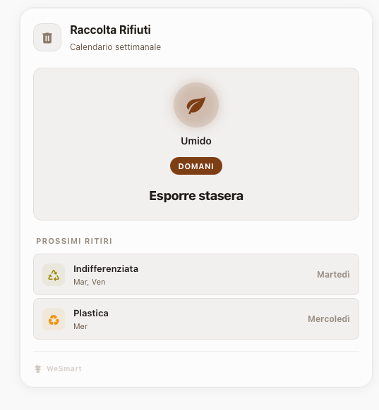
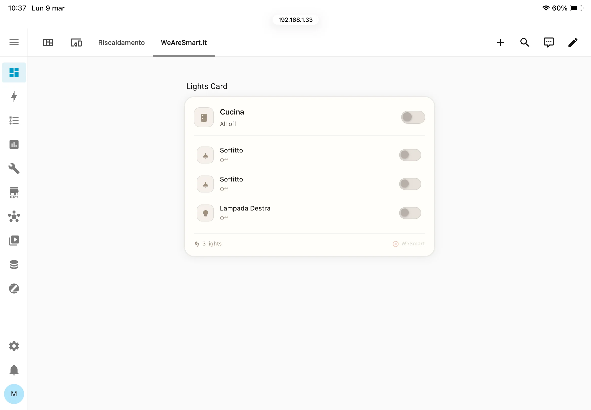
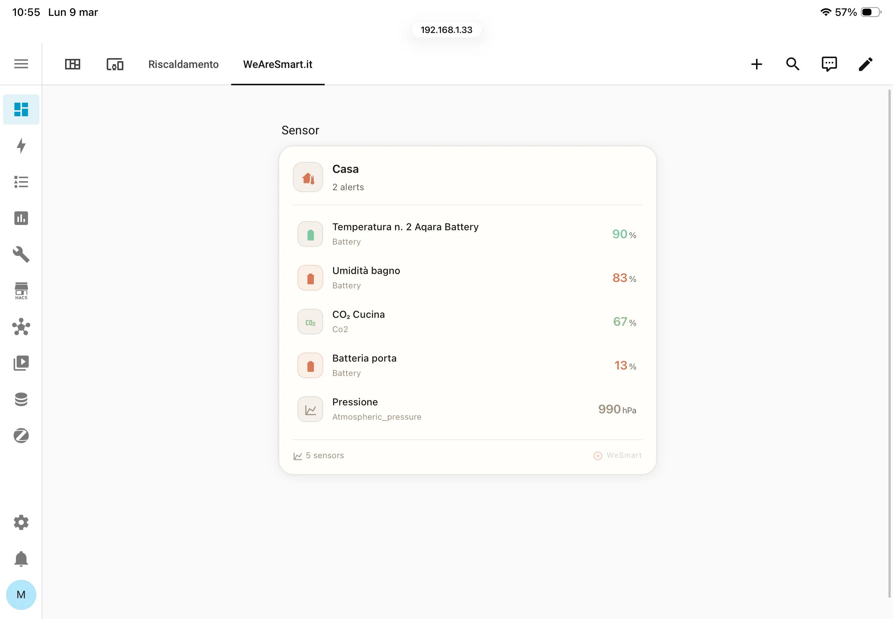
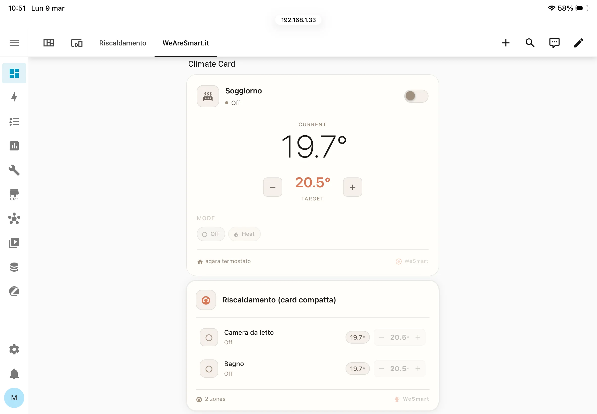
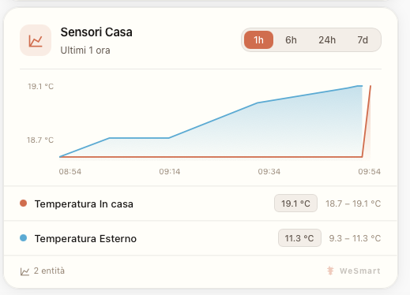
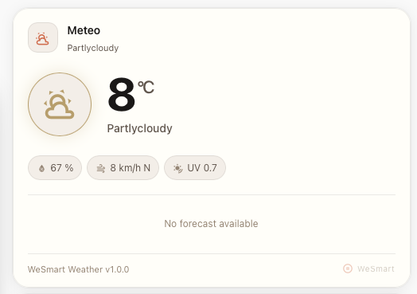
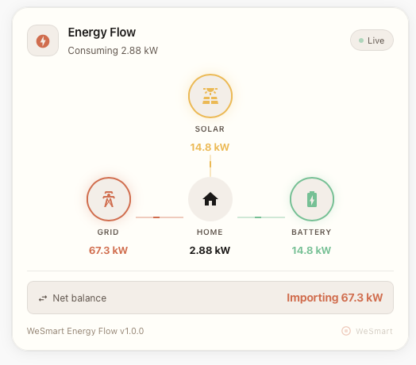
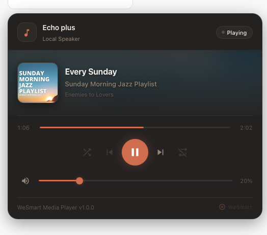

# WeSmart Custom Cards — Home Assistant

Una collezione unificata e completa di custom Lovelace card per Home Assistant, ispirate all'estetica **WeSmart AI**: tema scuro carbone caldo, accenti vivaci, tipografia minimale e motore cromatico dinamico nativo.

**Nessun build step. Nessuna dipendenza. 100% Pure Vanilla JS.**

---

### Fondatore e Visione / Founder & Vision

**Italiano:**  
Ciao! Sono **Massimo Di Vona** (precedentemente noto come *Max Novadi*), fondatore di [Wearesmart.it](https://www.wearesmart.it).  
Questo progetto nasce come un punto di riferimento per la community di Home Assistant. La mia visione è quella di unire la passione per la domotica con la potenza delle moderne **Intelligenze Artificiali** (*Gemini* e *Claude Code*). L'obiettivo è creare una suite completa di card eleganti, reattive e modulari, capaci di adattarsi perfettamente a qualsiasi tema. Tutte le card ora integrano nativamente il **motore cromatico dinamico (InfiniteColor)**: con il colore di default mantengono l'iconico stile WeSmart (carbone e arancione `#D97757`), ma permettono a ciascun utente di trasformarle istantaneamente in qualunque palette cromatica desiderata con un solo parametro YAML.

**English:**  
Hi! I'm **Massimo Di Vona** (formerly known as *Max Novadi*), founder of [Wearesmart.it](https://www.wearesmart.it).  
This project was born for the Home Assistant community, merging passion for smart homes with modern AI capabilities. All cards now natively feature the **Dynamic Color Engine**: by default, they preserve the signature WeSmart warm charcoal & orange (`#D97757`) look, while allowing you to tint them into any color palette via a single YAML hex parameter.

---

## 📢 Novità & Riorganizzazione 2.0

> [!IMPORTANT]
> **Suite Unificata (Original + InfiniteColor):**  
> Le collezioni *WeSmart Original* e *WeSmart InfiniteColor* sono state unificate nella cartella [`cards/`](cards/).  
> Grazie al motore dinamico nativo, ogni card riproduce lo stile originale WeSmart per impostazione predefinita ed è compatibile sia con `type: custom:wesmart-[nome]-card` che con `type: custom:wesmart-infinite-[nome]-card` (nessuna rottura delle dashboard esistenti).

> [!NOTE]
> **⚗️ WeSmart Labs Ufficialmente Chiuso:**  
> Il laboratorio sperimentale dei Labs è giunto al termine.
> - **WeSmart Garbage Solution**: ha completato con successo la fase di incubazione ed è ora una card ufficiale integrata in [`cards/Garbage/`](cards/Garbage/) e disponibile anche come repository standalone ([wesmart-garbage-card](https://github.com/WeAreSmart-home/wesmart-garbage-card) + [wesmart-garbage backend](https://github.com/WeAreSmart-home/wesmart-garbage)).
> - **Prototipi Layout** (*Home Panel, Clean Panel, Surface, Cross Pad*): sono stati ritirati dal branch attivo e archiviati nella cronologia Git del progetto.

---

## 🎨 Il Motore Cromatico Dinamico

Ogni card genera automaticamente l'intera palette di colori (sfondo, superfici, testi a contrasto, ombre, bordi e grafici) a partire da un singolo colore esadecimale (`color: '#HEX'`):

```yaml
color: '#D97757'  ──→  accento arancione classico WeSmart (default)
color: '#60B4D8'  ──→  blu fresco (ideale per climate/temperature)
color: '#7EC8A0'  ──→  verde salvia (ideale per porte/sicurezza)
color: '#A78BFA'  ──→  viola/indaco (ideale per scene e automazioni)
color: '#F59E0B'  ──→  ambra/oro (ideale per sensori ed energia)
```

Tutte le card supportano i temi `dark`, `light` e `auto` (segue in tempo reale il tema del sistema operativo via `prefers-color-scheme`).

---

## 📦 Catalogo Completo delle Card

La suite comprende **17 categorie** e oltre **20 card**:

| Card | Cartella | Tag YAML Principale | Alias Retrocompatibile | Entità / Tipo |
|------|----------|---------------------|------------------------|---------------|
| **Battery** | [`cards/Battery/`](cards/Battery/) | `wesmart-battery-card` | `wesmart-battery-status-card`, `wesmart-infinite-battery-card` | `sensor.*` (batterie) |
| **Buttons Bar** | [`cards/Buttons/`](cards/Buttons/) | `wesmart-buttons-bar-card` | `wesmart-infinite-buttons-bar-card` | qualsiasi / service |
| **Buttons Grid** | [`cards/Buttons/`](cards/Buttons/) | `wesmart-buttons-grid-card` | `wesmart-infinite-buttons-grid-card` | qualsiasi / service |
| **Chart** | [`cards/Chart/`](cards/Chart/) | `wesmart-chart-card` | `wesmart-infinite-chart-card` | qualsiasi sensore / multi |
| **Climate** | [`cards/Climate/`](cards/Climate/) | `wesmart-climate-card` | `wesmart-infinite-climate-card` | `climate.*` (singolo) |
| **Climate Compact** | [`cards/Climate/`](cards/Climate/) | `wesmart-climate-compact-card` | `wesmart-infinite-climate-compact-card` | `climate.*` (multi-zona) |
| **Clock** | [`cards/Clock/`](cards/Clock/) | `wesmart-clock-card` | `wesmart-infinite-clock-card` | orologio + fino a 3 entità |
| **Doors** | [`cards/Doors/`](cards/Doors/) | `wesmart-doors-card` | `wesmart-infinite-doors-card` | `binary_sensor.*` (porte/finestre) |
| **Energy Flow** | [`cards/Energy/`](cards/Energy/) | `wesmart-energy-flow-card` | `wesmart-infinite-energy-flow-card` | `sensor.*` (potenza/energia) |
| **Garbage** | [`cards/Garbage/`](cards/Garbage/) | `wesmart-garbage-card` | `wesmart-infinite-garbage-card` | calendario raccolta differenziata |
| **History** | [`cards/History/`](cards/History/) | `wesmart-history-card` | `wesmart-infinite-history-card`, `wesmart-infinite-color-card` | qualsiasi entità / cronologia |
| **Light ✨ v2.0** | [`cards/Light/`](cards/Light/) | `wesmart-light-card` | `wesmart-infinite-light-card` | `light.*` (singola, dimmer, rgb + **Visual Editor GUI**) |
| **Lights ✨ v2.0** | [`cards/Lights/`](cards/Lights/) | `wesmart-lights-card` | `wesmart-infinite-lights-card` | `light.*` (lista compatta + **Visual Editor GUI**) |
| **Lights Expand ✨ v2.0** | [`cards/Lights/`](cards/Lights/) | `wesmart-lights-expand-card` | `wesmart-infinite-lights-expand-card` | `light.*` (slider inline + **Visual Editor GUI**) |
| **Media Player** | [`cards/MediaPlayer/`](cards/MediaPlayer/) | `wesmart-media-player-card` | `wesmart-infinite-media-player-card` | `media_player.*` |
| **Person** | [`cards/Person/`](cards/Person/) | `wesmart-person-card` | `wesmart-infinite-person-card` | `person.*` (presenza e zone) |
| **Scene Interpolator** | [`cards/SceneInterpolator/`](cards/SceneInterpolator/) | `wesmart-scene-interpolator-card` | `wesmart-infinite-scene-interpolator-card` | `light.*` (morphing 2D 4 scene) |
| **Sensors** | [`cards/Sensors/`](cards/Sensors/) | `wesmart-sensors-card` | `wesmart-infinite-sensors-card` | `sensor.*` (multi-sensore) |
| **Switches** | [`cards/Switches/`](cards/Switches/) | `wesmart-switches-card` | `wesmart-infinite-switches-card` | `switch.*` (multi-interruttore) |
| **Weather** | [`cards/Weather/`](cards/Weather/) | `wesmart-weather-card` | `wesmart-infinite-weather-card` | `weather.*` (meteo e previsioni) |

---

## 🚀 Installazione Rapida

### 1. Copia i file JavaScript
Copia i file `.js` delle card desiderate (dalla cartella [`cards/`](cards/)) all'interno della cartella `config/www/` del tuo Home Assistant:
```
config/www/wesmart-light-card.js
config/www/wesmart-climate-card.js
config/www/wesmart-garbage-card.js
config/www/wesmart-chart-card.js
...
```

### 2. Aggiungi le Risorse in Lovelace
In Home Assistant vai su **Impostazioni → Dashboard → Risorse** (in alto a destra nei tre puntini) e aggiungi una risorsa per ciascun file:
- **URL**: `/local/wesmart-light-card.js`
- **Tipo**: `Modulo JavaScript`

### 3. Ricarica la Dashboard
Esegui un hard refresh del browser:
- `Cmd + Shift + R` (macOS)
- `Ctrl + Shift + R` (Windows / Linux)

---

## 🖼️ Anteprime Grafiche










---

## 🏗️ Architettura & Standard

Tutte le card sono sviluppate secondo i migliori standard web moderni:
- **Web Components**: ogni card estende `HTMLElement` ed è registrata tramite `customElements.define`.
- **Shadow DOM**: stili CSS completamente isolati e protetti tramite `attachShadow({ mode: 'open' })`.
- **Zero Dipendenze**: nessun framework pesante (React, Vue, Lit), nessun transpiler, nessun bundler.
- **Supporto Editor**: compatibilità con l'editor visuale di Lovelace e configurazione manuale YAML avanzata.

---

## 📖 Documentazione Dettagliata

Per la guida completa a ciascuna opzione di configurazione YAML, visualizza la documentazione tecnica in [`doc/README.md`](doc/README.md) o entra nella singola cartella in [`cards/`](cards/).

---

*Creato con passione da [Massimo Di Vona](https://www.wearesmart.it) & potenziato dall'Intelligenza Artificiale.*
