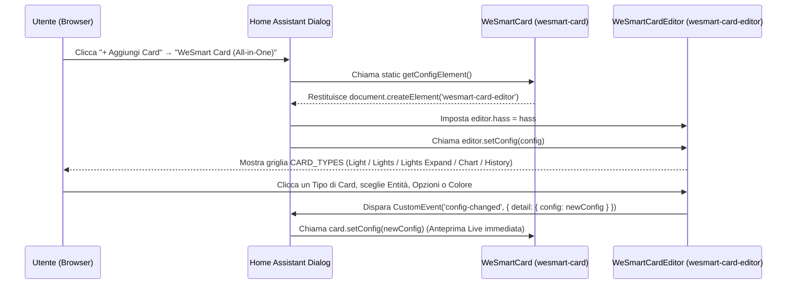

# WeSmart Card (`wesmart-card.js` v1.1.0) — Documentazione Tecnica & Architettura All-in-One

Questa guida documenta nel dettaglio l'architettura modulare di **`WeSmart-Card/wesmart-card.js`** (`type: custom:wesmart-card`), che rappresenta il **passo evolutivo successivo** rispetto alle card standalone precedenti: un **unico file JavaScript** che espone **un'unica card** nel selettore di Home Assistant e permette di scegliere, ottimizzare e configurare ogni tipologia di card (`card_type`) tramite il **Visual Editor GUI** integrato (`<wesmart-card-editor>`).

> **Obiettivo del Progetto**: Portare progressivamente tutte le card del catalogo WeSmart dentro questa nuova architettura All-in-One con configurazione grafica, migliorandole e aggiungendone di nuove.


---

## 1. Architettura Modulare `CARD_TYPES`

All'interno di `wesmart-card.js`, il registro `CARD_TYPES` definisce le tipologie di card selezionabili in cima alla finestra del configuratore visuale:

```js
const CARD_TYPES = [
  { id: 'light',         mode: 'single',  category: 'Lights', icon: 'mdi:lightbulb-on',         name: 'Light',         sub: '1 Luce · Slider completi' },
  { id: 'lights',        mode: 'list',    category: 'Lights', icon: 'mdi:format-list-bulleted', name: 'Lights',        sub: 'Multi-luce · Toggle rapidi' },
  { id: 'lights-expand', mode: 'expand',  category: 'Lights', icon: 'mdi:tune-vertical',        name: 'Lights Expand', sub: 'Multi-luce · Slider inline' },
  { id: 'chart',         mode: 'chart',   category: 'Graphs', icon: 'mdi:chart-areaspline',     name: 'Chart',         sub: 'Grafico Zoom & Tooltip' },
  { id: 'history',       mode: 'history', category: 'Graphs', icon: 'mdi:chart-timeline',       name: 'History',       sub: 'Storico per ogni riga' },
];
```

### Adattamento dinamico dell'Editor Visuale (`WeSmartCardEditor`)
Quando l'utente seleziona un `card_type` nel configuratore:
- **Modalità `light`**: mostra il selettore entità singola (`domain: light`) e i toggle dedicati agli slider luce (*Luminosità*, *Kelvin*, *Hue RGB*, *Comprimi da spenta*, *Colore Dinamico RGB*).
- **Modalità `lights` / `lights-expand`**: mostra l'elenco multi-entità con selettore filtrato su `domain: light`.
- **Modalità `chart` / `history`**:
  - Sblocca automaticamente il selettore **➕ Aggiungi Entità** su **tutti i domini** di Home Assistant (`sensor.*`, `binary_sensor.*`, `light.*`, `switch.*`, `climate.*`, ecc.).
  - Nella sezione **3. Controlli & Comportamento**, sostituisce le opzioni delle luci con i controlli dedicati ai grafici:
    - **Intervallo Temporale (`hours`)**: `1h`, `6h`, `24h`, `7d`
    - **Altezza Area Grafico (`height`, px)**: Slider da `60px` a `220px` (modalità `chart`)
    - **Mostra Griglia Orizzontale (`show_grid`)** (modalità `chart`)
    - **Abilita Drag-to-Zoom (`zoom`)** (modalità `chart`)

---

## 2. Ciclo di Vita del Visual Editor in Home Assistant (`getConfigElement`)



---

## 3. Riferimento Parametri (`custom:wesmart-card`)

### Opzioni Comuni a tutti i `card_type`

| Proprietà | Tipo | Default | Descrizione |
|---|---|---|---|
| `type` | `string` | **Obbligatorio** | `custom:wesmart-card` |
| `card_type` | `string` | `'light'` | Tipo di card: `'light'`, `'lights'`, `'lights-expand'`, `'chart'`, `'history'`. |
| `color` | `string` | `'#D97757'` | Colore base esadecimale (`#RRGGBB`) per il motore **InfiniteColor**. |
| `theme` | `string` | `'dark'` | Tema superficie: `'dark'`, `'light'` oppure `'auto'`. |
| `show_footer` | `boolean` | `true` | Mostra o nasconde il footer WeSmart. |

---

### Opzioni per `card_type: light` (Luce Singola)

| Proprietà | Tipo | Default | Descrizione |
|---|---|---|---|
| `entity` | `string` | **Obbligatorio** | Entità `light.*` (es. `light.soggiorno`). |
| `name` | `string` | `null` | Nome personalizzato. |
| `icon` | `string` | `null` | Icona MDI personalizzata (es. `mdi:floor-lamp`). |
| `show_brightness` | `boolean` | `true` | Mostra lo slider Luminosità (1–100%). |
| `show_color_temp` | `boolean` | `true` | Mostra lo slider Temperatura Colore (Kelvin), se supportato. |
| `show_color` | `boolean` | `true` | Mostra lo slider Colore RGB (Hue 0–360°), se supportato. |
| `collapse_when_off` | `boolean` | `false` | Nasconde gli slider quando la luce è spenta. |
| `dynamic_light_color` | `boolean` | `false` | Adatta l'accento della card al colore reale RGB della lampadina accesa. |

---

### Opzioni per `card_type: lights` & `card_type: lights-expand` (Multi-Luce)

| Proprietà | Tipo | Default | Descrizione |
|---|---|---|---|
| `title` | `string` | `'Lights'` | Titolo del gruppo mostrato nell'header. |
| `icon` | `string` | `'mdi:lightbulb-group'` | Icona mostrata nell'header del gruppo. |
| `entities` | `array` | **Obbligatorio** | Array di stringhe (`light.id`) o oggetti `{ entity, name, icon }`. |

---

### Opzioni per `card_type: chart` & `card_type: history` (Grafici & Storico)

| Proprietà | Tipo | Default | Descrizione |
|---|---|---|---|
| `title` | `string` | `'Grafico'` / `'History'` | Titolo mostrato nell'header della card. |
| `icon` | `string` | `'mdi:chart-areaspline'` | Icona mostrata nell'header. |
| `entities` | `array` | **Obbligatorio** | Lista di qualsiasi entità (`sensor.*`, `binary_sensor.*`, `light.*`, ecc.) come stringa o `{ entity, name, icon }`. |
| `hours` | `number` | `24` | Intervallo temporale iniziale in ore (`1`, `6`, `24`, `168`). |
| `height` | `number` | `100` | *(Solo `chart`)* Altezza in pixel dell'area del grafico SVG (`60` – `220`). |
| `show_grid` | `boolean` | `false` | *(Solo `chart`)* Mostra le linee guida orizzontali dietro il grafico. |
| `zoom` | `boolean` | `true` | *(Solo `chart`)* Abilita il Drag-to-Zoom interattivo col mouse o touch (doppio clic per resettare). |
