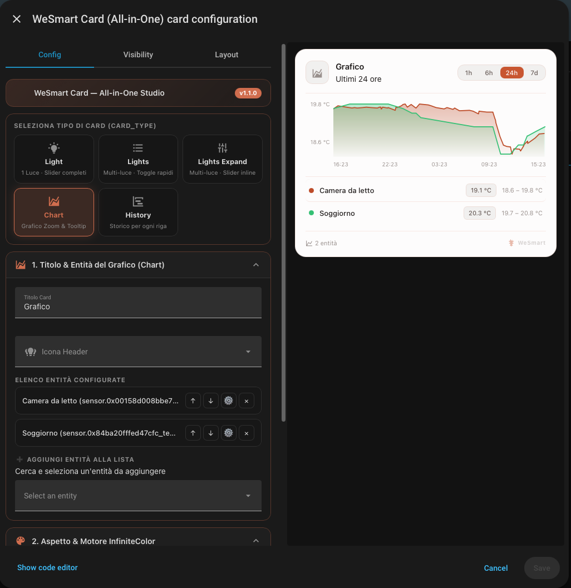
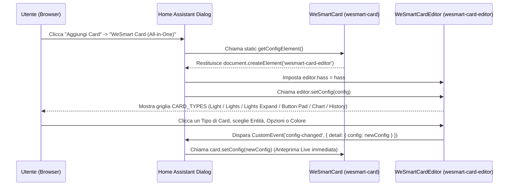

# WeSmart Card (`wesmart-card.js` v1.4.0-exp) — Technical Documentation & Architecture

**[Italiano](#italiano)** | **[English](#english)**



---

<a name="italiano"></a>
## Italiano

Questa guida documenta nel dettaglio l'architettura modulare di **`WeSmart-Card/wesmart-card.js`** (`type: custom:wesmart-card`), che rappresenta il passo evolutivo successivo rispetto alle card standalone precedenti: un **unico file JavaScript** che espone **un'unica card** nel selettore di Home Assistant e permette di scegliere, ottimizzare e configurare ogni tipologia di card (`card_type`) tramite il **Visual Editor GUI** integrato (`<wesmart-card-editor>`).

> **Obiettivo del Progetto**: Portare progressivamente tutte le card del catalogo WeSmart dentro questa nuova architettura All-in-One con configurazione grafica, migliorandole e aggiungendone di nuove.

---

### 1. Architettura Modulare `CARD_TYPES`

All'interno di `wesmart-card.js`, il registro `CARD_TYPES` definisce le tipologie di card selezionabili in cima alla finestra del configuratore visuale:

```js
const CARD_TYPES = [
  { id: 'light',         mode: 'single',  category: 'Lights',   icon: 'mdi:lightbulb-on',         name: 'Light',         sub: '1 Luce · Slider completi' },
  { id: 'lights',        mode: 'list',    category: 'Lights',   icon: 'mdi:format-list-bulleted', name: 'Lights',        sub: 'Multi-luce · Toggle rapidi' },
  { id: 'lights-expand', mode: 'expand',  category: 'Lights',   icon: 'mdi:tune-vertical',        name: 'Lights Expand', sub: 'Multi-luce · Slider inline' },
  { id: 'button',        mode: 'button',  category: 'Controls', icon: 'mdi:gesture-tap-button',   name: 'Button Pad',    sub: 'Tasto Mixer 1x1 / 2x2 · LED' },
  { id: 'chart',         mode: 'chart',   category: 'Graphs',   icon: 'mdi:chart-areaspline',     name: 'Chart',         sub: 'Grafico Zoom & Tooltip' },
  { id: 'history',       mode: 'history', category: 'Graphs',   icon: 'mdi:chart-timeline',       name: 'History',       sub: 'Storico per ogni riga' },
];
```

#### Adattamento dinamico dell'Editor Visuale (`WeSmartCardEditor`)
Quando l'utente seleziona un `card_type` nel configuratore:
- **Modalità `light`**: mostra il selettore entità singola (`domain: light`) e i toggle dedicati agli slider luce (*Luminosità*, *Kelvin*, *Hue RGB*, *Comprimi da spenta*, *Colore Dinamico RGB*).
- **Modalità `button` (Button Pad Mixer)**:
  - Sblocca il selettore entità singola per **tutti i domini** (`light.*`, `scene.*`, `switch.*`, `script.*`, `input_boolean.*`, `button.*`).
  - Mostra i controlli dedicati al tasto fisico da mixer:
    - **Formato & Dimensione (`button_size`)**: `1x1` (`136x136px`), `2x2` (`220x220px`) o `full` (100% larghezza).
    - **Azioni `tap_action` e `hold_action`**: `toggle`, `more-info`, `turn_on`, `turn_off`, `call-service` (con campo servizio personalizzato `tap_service` / `hold_service`), `none`.
    - **Visibilità elementi**: toggle per mostrare/nascondere `show_icon`, `show_name` e `show_state`.
- **Modalità `lights` / `lights-expand`**: mostra l'elenco multi-entità con selettore filtrato su `domain: light`.
- **Modalità `chart` / `history`**:
  - Sblocca automaticamente il selettore di aggiunta entità su **tutti i domini** di Home Assistant (`sensor.*`, `binary_sensor.*`, `light.*`, `switch.*`, `climate.*`, ecc.).
  - Nelle impostazioni di ciascuna entità della lista, aggiunge il selettore **Colore Entità** (pulsante `Auto` per la rotazione cromatica automatica, 10 swatch rapidi, color picker nativo e campo HEX `#RRGGBB`).
  - Nella sezione **3. Controlli & Comportamento**, sostituisce le opzioni delle luci con i controlli dedicati ai grafici:
    - **Intervallo Temporale (`hours`)**: `1h`, `6h`, `24h`, `7d`
    - **Calcolo Valori Grafico (`aggregation`)**: `Valori Puntuali` (`raw`, ogni variazione istantanea reale ancorata ai bordi temporali) oppure `Media Aggregata` (`avg`, media ponderata nel tempo su intervalli regolari)
    - **Altezza Area Grafico (`height`, px)**: Slider da `60px` a `220px` (modalità `chart`)
    - **Mostra Griglia Orizzontale (`show_grid`)** (modalità `chart`)
    - **Abilita Drag-to-Zoom (`zoom`)** (modalità `chart`)

---

### 2. Ciclo di Vita del Visual Editor in Home Assistant (`getConfigElement`)



---

### 3. Riferimento Parametri (`custom:wesmart-card`)

#### Opzioni Comuni a tutti i `card_type`

| Proprietà | Tipo | Default | Descrizione |
|---|---|---|---|
| `type` | `string` | **Obbligatorio** | `custom:wesmart-card` |
| `card_type` | `string` | `'light'` | Tipo di card: `'light'`, `'lights'`, `'lights-expand'`, `'button'`, `'chart'`, `'history'`. |
| `color` | `string` | `'#D97757'` | Colore base esadecimale (`#RRGGBB`) per il motore **InfiniteColor**. |
| `theme` | `string` | `'dark'` | Tema superficie: `'dark'`, `'light'` oppure `'auto'`. |
| `bg_color` | `string` | `null` *(Auto)* | Colore di sfondo personalizzato (`#RRGGBB`) che sovrascrive lo sfondo predefinito del tema e ricalcola il tono delle superfici interne. |
| `bg_opacity` | `number` | `100` | Opacità dello sfondo della card da `0` a `100` (%). A `0%` la card diventa completamente trasparente e rimuove automaticamente anche bordi e ombra. |
| `show_border` | `boolean` | `true` | Mostra o nasconde il contorno e l'ombra esterna della card (a `bg_opacity: 0` viene disattivato automaticamente). |
| `show_footer` | `boolean` | `true` | Mostra o nasconde il footer WeSmart. |

#### Opzioni per `card_type: light` (Luce Singola)

| Proprietà | Tipo | Default | Descrizione |
|---|---|---|---|
| `entity` | `string` | **Obbligatorio** | Entità `light.*` (es. `light.soggiorno`). |
| `name` | `string` | `null` | Nome personalizzato. |
| `icon` | `string` | `null` | Icona MDI personalizzata (es. `mdi:floor-lamp`). |
| `show_brightness` | `boolean` | `true` | Mostra lo slider Luminosità (1–100%). |
| `show_color_temp` | `boolean` | `true` | Mostra lo slider Temperatura Colore (Kelvin), se supportato. |
| `show_color` | `boolean` | `true` | Mostra lo slider Colore RGB (Hue 0–360°), se supportato. |
| `collapse_when_off` | `boolean` | `false` | Nasconde gli slider quando la luce è spenta. |
| `dynamic_light_color` | `boolean` | `false` | Adatta l'accento della card al colore reale RGB della lampadina accesa. |

#### Opzioni per `card_type: button` (Button Pad / Tasto Fisico Mixer)

| Proprietà | Tipo | Default | Descrizione |
|---|---|---|---|
| `entity` | `string` | **Obbligatorio** | Qualsiasi entità (`light.*`, `scene.*`, `switch.*`, `script.*`, `input_boolean.*`, `button.*`). |
| `name` | `string` | `null` | Etichetta personalizzata sul tasto. |
| `icon` | `string` | `null` | Icona MDI personalizzata sul tasto. |
| `button_size` | `string` | `'1x1'` | Formato del tasto: `'1x1'` (`136x136px`), `'2x2'` (`220x220px`) oppure `'full'` (100% larghezza). |
| `show_icon` | `boolean` | `true` | Mostra o nasconde l'icona sul tasto. |
| `show_name` | `boolean` | `true` | Mostra o nasconde il nome/etichetta sul tasto (se nascosto, l'icona si centra e si ingrandisce). |
| `show_state` | `boolean` | `true` | Mostra o nasconde la riga di stato sotto al nome. |
| `tap_action` | `string` | `'toggle'` | Azione al tocco breve: `'toggle'`, `'more-info'`, `'turn_on'`, `'turn_off'`, `'call-service'`, `'none'`. |
| `hold_action` | `string` | `'more-info'` | Azione alla pressione prolungata (500ms): `'more-info'`, `'toggle'`, `'turn_on'`, `'turn_off'`, `'call-service'`, `'none'`. |
| `tap_service` | `string` | `null` | Servizio da eseguire se `tap_action: 'call-service'` (es. `'scene.turn_on'`). |
| `hold_service` | `string` | `null` | Servizio da eseguire se `hold_action: 'call-service'` (es. `'script.buonanotte'`). |
| `dynamic_light_color` | `boolean` | `false` | Adatta il colore del LED angolare e dell'icona al colore reale RGB della lampadina accesa. |

#### Opzioni per `card_type: lights` e `card_type: lights-expand` (Multi-Luce)

| Proprietà | Tipo | Default | Descrizione |
|---|---|---|---|
| `title` | `string` | `'Lights'` | Titolo del gruppo mostrato nell'header. |
| `icon` | `string` | `'mdi:lightbulb-group'` | Icona mostrata nell'header del gruppo. |
| `entities` | `array` | **Obbligatorio** | Array di stringhe (`light.id`) o oggetti `{ entity, name, icon }`. |

#### Opzioni per `card_type: chart` e `card_type: history` (Grafici & Storico)

| Proprietà | Tipo | Default | Descrizione |
|---|---|---|---|
| `title` | `string` | `'Grafico'` / `'History'` | Titolo mostrato nell'header della card. |
| `icon` | `string` | `'mdi:chart-areaspline'` | Icona mostrata nell'header. |
| `entities` | `array` | **Obbligatorio** | Lista di qualsiasi entità (`sensor.*`, `binary_sensor.*`, `light.*`, ecc.) come stringa o oggetto `{ entity, name, icon, color }`. Se `color` (`#RRGGBB`) non è specificato, viene assegnato un colore automatico armonizzato col tema. |
| `aggregation` | `string` | `'raw'` | Metodo di calcolo dei valori sul grafico: `'raw'` (**Valori puntuali** istantanei reali) oppure `'avg'` (**Media ponderata** nel tempo per intervalli regolari: `5m` su 1h, `15m` su 6h, `30m` su 24h, `3h` su 7d). Commutabile anche dal vivo sulla card. |
| `hours` | `number` | `24` | Intervallo temporale iniziale in ore (`1`, `6`, `24`, `168`). |
| `height` | `number` | `100` | *(Solo `chart`)* Altezza in pixel dell'area del grafico SVG (`60` – `220`). |
| `show_grid` | `boolean` | `false` | *(Solo `chart`)* Mostra le linee guida orizzontali dietro il grafico. |
| `zoom` | `boolean` | `true` | *(Solo `chart`)* Abilita il Drag-to-Zoom interattivo col mouse o touch (doppio clic per resettare). |

---

<a name="english"></a>
## English

This guide documents the modular architecture of **`WeSmart-Card/wesmart-card.js`** (`type: custom:wesmart-card`), which represents the next evolutionary step beyond standalone WeSmart cards: a **single JavaScript file** that registers **a single card** in the Home Assistant card picker and lets users select, optimize, and configure every card type (`card_type`) via the built-in **Visual Editor GUI** (`<wesmart-card-editor>`).

> **Project Goal**: Progressively migrate all cards from the WeSmart catalog into this unified All-in-One architecture with graphical configuration, improving existing cards and introducing new ones.

---

### 1. Modular `CARD_TYPES` Architecture

Inside `wesmart-card.js`, the `CARD_TYPES` registry defines the card types selectable at the top of the visual configurator:

```js
const CARD_TYPES = [
  { id: 'light',         mode: 'single',  category: 'Lights',   icon: 'mdi:lightbulb-on',         name: 'Light',         sub: '1 Luce · Slider completi' },
  { id: 'lights',        mode: 'list',    category: 'Lights',   icon: 'mdi:format-list-bulleted', name: 'Lights',        sub: 'Multi-luce · Toggle rapidi' },
  { id: 'lights-expand', mode: 'expand',  category: 'Lights',   icon: 'mdi:tune-vertical',        name: 'Lights Expand', sub: 'Multi-luce · Slider inline' },
  { id: 'button',        mode: 'button',  category: 'Controls', icon: 'mdi:gesture-tap-button',   name: 'Button Pad',    sub: 'Tasto Mixer 1x1 / 2x2 · LED' },
  { id: 'chart',         mode: 'chart',   category: 'Graphs',   icon: 'mdi:chart-areaspline',     name: 'Chart',         sub: 'Grafico Zoom & Tooltip' },
  { id: 'history',       mode: 'history', category: 'Graphs',   icon: 'mdi:chart-timeline',       name: 'History',       sub: 'Storico per ogni riga' },
];
```

#### Dynamic Adaptation in the Visual Editor (`WeSmartCardEditor`)
When the user selects a `card_type` in the configurator:
- **`light` mode**: displays the single-entity picker (`domain: light`) and dedicated light slider toggles (*Brightness*, *Kelvin*, *Hue RGB*, *Collapse when off*, *Dynamic RGB light color*).
- **`button` mode (Button Pad Mixer)**:
  - Unlocks the single-entity picker across **all domains** (`light.*`, `scene.*`, `switch.*`, `script.*`, `input_boolean.*`, `button.*`).
  - Displays physical mixer button controls:
    - **Button Size (`button_size`)**: `1x1` (`136x136px`), `2x2` (`220x220px`), or `full` (100% width).
    - **Tap (`tap_action`) & Hold (`hold_action`) Actions**: `toggle`, `more-info`, `turn_on`, `turn_off`, `call-service` (with custom `tap_service` / `hold_service` inputs), `none`.
    - **Element Visibility**: toggles for `show_icon`, `show_name`, and `show_state`.
- **`lights` / `lights-expand` modes**: displays the multi-entity list manager with the entity picker filtered to `domain: light`.
- **`chart` / `history` modes**:
  - Automatically unlocks the entity picker across **all Home Assistant domains** (`sensor.*`, `binary_sensor.*`, `light.*`, `switch.*`, `climate.*`, etc.).
  - In each entity's inline edit panel, adds the **Entity Color** picker (`Auto` button for automatic golden-angle palette, 10 quick swatches, native color input, and `#RRGGBB` HEX field).
  - In section **3. Controls & Behavior**, replaces light-specific toggles with chart controls:
    - **Default Time Range (`hours`)**: `1h`, `6h`, `24h`, `7d`
    - **Chart Value Calculation (`aggregation`)**: `Raw Points` (`raw`, instantaneous state changes anchored across the time window) or `Time-Weighted Average` (`avg`, time-weighted bucket averages)
    - **Chart Area Height (`height`, px)**: Slider from `60px` to `220px` (`chart` mode)
    - **Show Horizontal Grid (`show_grid`)** (`chart` mode)
    - **Enable Drag-to-Zoom (`zoom`)** (`chart` mode)

---

### 2. Visual Editor Lifecycle in Home Assistant (`getConfigElement`)

1. **`static getConfigElement()`**: Called by Home Assistant Lovelace when opening the card configuration dialog; returns `document.createElement('wesmart-card-editor')`.
2. **`static getStubConfig(hass, entities)`**: Provides the initial default configuration (`card_type: 'light'`, `color: '#D97757'`, `theme: 'dark'`).
3. **`config-changed` CustomEvent**: Fired by `WeSmartCardEditor` whenever any option is modified, updating the live card preview in real time.

---

### 3. Configuration Parameters Reference (`custom:wesmart-card`)

#### Global Options (Shared across all `card_type` modes)

| Property | Type | Default | Description |
|---|---|---|---|
| `type` | `string` | **Required** | `custom:wesmart-card` |
| `card_type` | `string` | `'light'` | Card mode: `'light'`, `'lights'`, `'lights-expand'`, `'button'`, `'chart'`, `'history'`. |
| `color` | `string` | `'#D97757'` | Base HEX color (`#RRGGBB`) for the **InfiniteColor** engine. |
| `theme` | `string` | `'dark'` | Surface theme: `'dark'`, `'light'`, or `'auto'`. |
| `bg_color` | `string` | `null` *(Auto)* | Custom background color (`#RRGGBB`) overriding the default theme background and adapting inner surface tones. |
| `bg_opacity` | `number` | `100` | Background opacity from `0` to `100` (%). At `0%` the card becomes completely transparent and automatically removes borders and shadows. |
| `show_border` | `boolean` | `true` | Shows or hides the outer card border and shadow (automatically disabled when `bg_opacity: 0`). |
| `show_footer` | `boolean` | `true` | Shows or hides the bottom WeSmart status bar. |

#### Options for `card_type: light` (Single Light)

| Property | Type | Default | Description |
|---|---|---|---|
| `entity` | `string` | **Required** | `light.*` entity ID (e.g. `light.living_room`). |
| `name` | `string` | `null` | Custom display name override. |
| `icon` | `string` | `null` | Custom MDI icon override (e.g. `mdi:floor-lamp`). |
| `show_brightness` | `boolean` | `true` | Displays the Brightness slider (1–100%). |
| `show_color_temp` | `boolean` | `true` | Displays the Color Temperature slider (Kelvin), if supported. |
| `show_color` | `boolean` | `true` | Displays the RGB Hue slider (0–360°), if supported. |
| `collapse_when_off` | `boolean` | `false` | Collapses all sliders when the light is turned off. |
| `dynamic_light_color` | `boolean` | `false` | Tints the card accent with the real RGB color of the active bulb. |

#### Options for `card_type: button` (Button Pad / Physical Mixer Key)

| Property | Type | Default | Description |
|---|---|---|---|
| `entity` | `string` | **Required** | Any entity ID (`light.*`, `scene.*`, `switch.*`, `script.*`, `input_boolean.*`, `button.*`). |
| `name` | `string` | `null` | Custom button label override. |
| `icon` | `string` | `null` | Custom MDI icon override. |
| `button_size` | `string` | `'1x1'` | Button format: `'1x1'` (`136x136px`), `'2x2'` (`220x220px`), or `'full'` (100% width). |
| `show_icon` | `boolean` | `true` | Shows or hides the button icon. |
| `show_name` | `boolean` | `true` | Shows or hides the button name/text (when hidden, the icon automatically centers and scales up). |
| `show_state` | `boolean` | `true` | Shows or hides the status line below the name. |
| `tap_action` | `string` | `'toggle'` | Short press action: `'toggle'`, `'more-info'`, `'turn_on'`, `'turn_off'`, `'call-service'`, `'none'`. |
| `hold_action` | `string` | `'more-info'` | Long press action (500ms): `'more-info'`, `'toggle'`, `'turn_on'`, `'turn_off'`, `'call-service'`, `'none'`. |
| `tap_service` | `string` | `null` | Service to call when `tap_action: 'call-service'` (e.g. `'scene.turn_on'`). |
| `hold_service` | `string` | `null` | Service to call when `hold_action: 'call-service'` (e.g. `'script.goodnight'`). |
| `dynamic_light_color` | `boolean` | `false` | Tints the corner LED and icon with the real RGB color of the active bulb. |

#### Options for `card_type: lights` & `card_type: lights-expand` (Multi-Light)

| Property | Type | Default | Description |
|---|---|---|---|
| `title` | `string` | `'Lights'` | Group title displayed in the card header. |
| `icon` | `string` | `'mdi:lightbulb-group'` | Header icon for the group. |
| `entities` | `array` | **Required** | Array of entity ID strings (`light.id`) or objects `{ entity, name, icon }`. |

#### Options for `card_type: chart` & `card_type: history` (Graphs & History)

| Property | Type | Default | Description |
|---|---|---|---|
| `title` | `string` | `'Grafico'` / `'History'` | Header title. |
| `icon` | `string` | `'mdi:chart-areaspline'` | Header icon. |
| `entities` | `array` | **Required** | List of any entities (`sensor.*`, `binary_sensor.*`, `light.*`, etc.) as strings or `{ entity, name, icon, color }` objects. If `color` (`#RRGGBB`) is omitted, an automatic theme-harmonized color is assigned. |
| `aggregation` | `string` | `'raw'` | Value calculation mode: `'raw'` (instantaneous **Raw points**) or `'avg'` (**Time-weighted average** grouped by interval: `5m` for 1h, `15m` for 6h, `30m` for 24h, `3h` for 7d). Can also be toggled live on the card. |
| `hours` | `number` | `24` | Default time range in hours (`1`, `6`, `24`, `168`). |
| `height` | `number` | `100` | *(`chart` only)* Height in pixels of the SVG chart area (`60` – `220`). |
| `show_grid` | `boolean` | `false` | *(`chart` only)* Renders horizontal guide lines behind the chart. |
| `zoom` | `boolean` | `true` | *(`chart` only)* Enables interactive mouse/touch Drag-to-Zoom (double-click to reset). |
