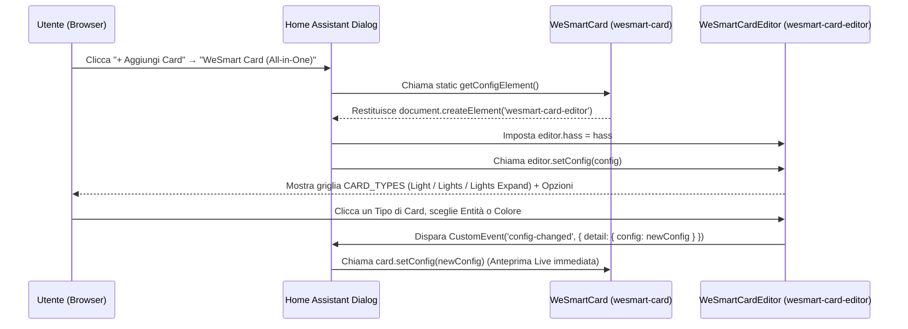

# WeSmart Card (`wesmart-card.js`) — Documentazione Tecnica & Architettura All-in-One

Questa guida documenta nel dettaglio l'architettura modulare di **`WeSmart-Card/wesmart-card.js`** (`type: custom:wesmart-card`), progettata sul modello di *Bubble Card*: un **unico file JavaScript** che espone **un'unica card** nel selettore di Home Assistant e permette di scegliere e configurare ogni tipologia di card (`card_type`) tramite il **Visual Editor GUI** integrato (`<wesmart-card-editor>`).

---

## 1. Architettura Modulare `CARD_TYPES`

All'interno di `wesmart-card.js`, il registro `CARD_TYPES` definisce le tipologie di card selezionabili in cima alla finestra del configuratore visuale:

```js
const CARD_TYPES = [
  { id: 'light',         mode: 'single', category: 'Lights', icon: 'mdi:lightbulb-on',         name: 'Light',         sub: '1 Luce · Slider completi' },
  { id: 'lights',        mode: 'list',   category: 'Lights', icon: 'mdi:format-list-bulleted', name: 'Lights',        sub: 'Multi-luce · Toggle rapidi' },
  { id: 'lights-expand', mode: 'expand', category: 'Lights', icon: 'mdi:tune-vertical',        name: 'Lights Expand', sub: 'Multi-luce · Slider inline' },
  // Prossimi moduli:
  // { id: 'climate',         mode: 'climate',         category: 'Climate', icon: 'mdi:thermostat', ... },
  // { id: 'climate-compact', mode: 'climate-compact', category: 'Climate', icon: 'mdi:home-thermometer', ... },
  // { id: 'sensors',         mode: 'sensors',         category: 'Sensors', icon: 'mdi:chart-box-outline', ... },
];
```

### Come aggiungere una nuova tipologia di Card in futuro
Per estendere `wesmart-card.js` con una nuova card (es. `climate` o `sensors`):
1. Aggiungere la voce corrispondente nell'array `CARD_TYPES`.
2. Aggiungere il renderer HTML e i listener nella classe `WeSmartCard` (`_getClimateHTML()`, `_bindClimateEvents()`, `_updateClimateState()`).
3. Aggiungere il pannello opzioni specifico in `WeSmartCardEditor` (mentre la sezione **2. Aspetto & Motore InfiniteColor** è già condivisa automaticamente da tutte le tipologie!).

---

## 2. Ciclo di Vita del Visual Editor in Home Assistant (`getConfigElement`)



---

## 3. Riferimento Parametri (`custom:wesmart-card`)

### Opzioni Comuni a tutti i `card_type`

| Proprietà | Tipo | Default | Descrizione |
|---|---|---|---|
| `type` | `string` | **Obbligatorio** | `custom:wesmart-card` |
| `card_type` | `string` | `'light'` | Tipo di card: `'light'` (alias `'single'`), `'lights'` (alias `'list'`), `'lights-expand'` (alias `'expand'`). |
| `color` | `string` | `'#D97757'` | Colore base esadecimale (`#RRGGBB`) per il motore **InfiniteColor**. |
| `theme` | `string` | `'dark'` | Tema superficie: `'dark'`, `'light'` oppure `'auto'`. |
| `show_footer` | `boolean` | `true` | Mostra o nasconde il footer WeSmart. |

---

### Opzioni per `card_type: light` (Luce Singola)

| Proprietà | Tipo | Default | Descrizione |
|---|---|---|---|
| `entity` | `string` | **Obbligatorio** | Entità `light.*` (es. `light.soggiorno`). |
| `name` | `string` | `null` | Nome personalizzato. |
| `icon` | `string` | `null` | Icona MDI personalizzata (es. `mdi:floor-lamp`). |
| `show_brightness` | `boolean` | `true` | Mostra lo slider Luminosità (1–100%). |
| `show_color_temp` | `boolean` | `true` | Mostra lo slider Temperatura Colore (Kelvin), se supportato. |
| `show_color` | `boolean` | `true` | Mostra lo slider Colore RGB (Hue 0–360°), se supportato. |
| `collapse_when_off` | `boolean` | `false` | Nasconde gli slider quando la luce è spenta. |
| `dynamic_light_color` | `boolean` | `false` | Adatta l'accento della card al colore reale RGB della lampadina accesa. |

---

### Opzioni per `card_type: lights` & `card_type: lights-expand` (Multi-Luce)

| Proprietà | Tipo | Default | Descrizione |
|---|---|---|---|
| `title` | `string` | `'Lights'` | Titolo del gruppo mostrato nell'header. |
| `icon` | `string` | `'mdi:lightbulb-group'` | Icona mostrata nell'header del gruppo. |
| `entities` | `array` | **Obbligatorio** | Array di stringhe (`light.id`) o oggetti `{ entity, name, icon }`. |
