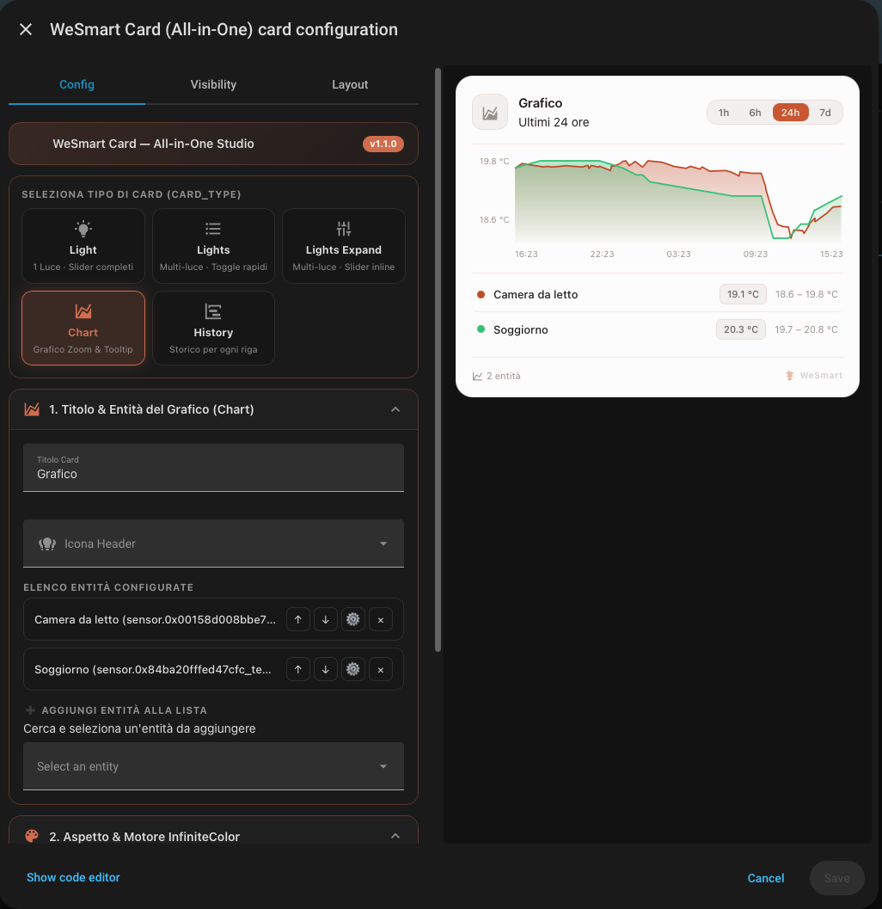

# WeSmart Card (`wesmart-card.js` v1.1.0) — All-in-One Modular Suite

**[Italiano](#italiano)** | **[English](#english)**



---

<a name="italiano"></a>
## Italiano

**`WeSmart-Card`** rappresenta il passo evolutivo successivo rispetto alle card singole WeSmart: un sistema **All-in-One** per Home Assistant pensato per migliorare, unificare e ottimizzare l'esperienza d'uso grazie a **un solo file `.js` da installare** (`wesmart-card.js`) e a una **finestra di configurazione grafica dedicata (Visual Editor GUI)** ispirata al paradigma *Bubble Card*.

### Visione e Obiettivo del Progetto

Dopo aver consolidato il catalogo delle card standalone (nella cartella `cards/`) e il motore cromatico **InfiniteColor**, l'obiettivo di **`WeSmart-Card`** è:
1. **Configurazione Visuale (Zero YAML obbligatorio)**: configurare qualsiasi card, entità, opzione e palette cromatica direttamente dall'interfaccia visuale di Home Assistant con anteprima in tempo reale.
2. **Un solo file per tutte le card**: eliminare la necessità di registrare decine di risorse separate in Lovelace; basta installare `wesmart-card.js` e selezionare il **Tipo di Card (`card_type`)** in cima al configuratore.
3. **Migrazione, Ottimizzazione e Nuove Card**: il goal del progetto è portare progressivamente **tutte le card WeSmart** dentro questa nuova architettura All-in-One, migliorandone prestazioni, animazioni e opzioni di personalizzazione, oltre a introdurre nuove tipologie di card.

---

### Tipi di Card Integrati (`card_type` — v1.1.0)

Appena aggiungi **WeSmart Card (All-in-One)** nella tua dashboard, in cima alla finestra di configurazione puoi selezionare tra **5 tipologie**:

| `card_type` | Nome | Descrizione |
|---|---|---|
| **`light`** *(Default)* | **Light (Singola)** | Controllo completo per 1 luce con slider interattivi per Luminosità (1–100%), Temperatura Colore (Kelvin) e Colore RGB (Hue 0–360°). |
| **`lights`** | **Lights (Lista)** | Lista multi-luce compatta con Master Toggle di gruppo nell'header, toggle singoli per riga e apertura dialogo *More Info* al tap. |
| **`lights-expand`** | **Lights Expand** | Lista multi-luce espandibile a fisarmonica: cliccando su una riga accesa si apre un pannello animato inline con slider di Luminosità e Temperatura Colore. |
| **`chart`** | **Chart (Grafico)** | Grafico interattivo per 1 o più entità sovrapposte (sensori numerici o binari) con Drag-to-Zoom, Tooltip hover, selettori temporali (`1h` / `6h` / `24h` / `7d`), altezza regolabile e griglia. |
| **`history`** | **History (Storico)** | Lista storica multi-entità dove ogni riga ha il proprio mini-grafico dedicato (curva SVG con `min – max` per sensori numerici, barra timeline con `Attivo X%` per entità binarie). |

---

### Roadmap di Migrazione verso `WeSmart-Card`

| Modulo / Famiglia | Stato in `wesmart-card.js` | Caratteristiche nella Nuova Versione GUI |
|---|---|---|
| **Light (Singola)** | Disponibile (`v1.0+`) | Selettore entità nativo, toggle slider Luminosità/Kelvin/RGB, colore dinamico RGB |
| **Lights (Lista)** | Disponibile (`v1.0+`) | Gestore lista interattivo (riordino, nome/icona per riga, Master Toggle) |
| **Lights Expand** | Disponibile (`v1.0+`) | Fisarmonica inline animata Luminosità + Kelvin per ogni riga |
| **Chart (Grafico)** | Disponibile (`v1.1+`) | Qualsiasi sensore, Drag-to-Zoom, Tooltip, selettore `1h/6h/24h/7d`, slider altezza e griglia |
| **History (Storico)** | Disponibile (`v1.1+`) | Mini-grafico linea o barra timeline per riga con statistiche `min–max` / `Attivo %` |
| **Climate & Compact** | In arrivo | Termostato singolo e multi-zona con configurazione visuale HVAC e step temperatura |
| **Sensors & Battery** | In arrivo | Soglie alert visuali, display lineare/circolare/icona da GUI |
| **Doors & Switches** | In arrivo | Sensori porte/finestre e interruttori multi-entità con icone dinamiche |
| **Buttons Bar & Grid** | In arrivo | Creazione visuale di pulsanti rapidi, scene e chiamate servizio |
| **Energy, Weather & Media** | In arrivo | Flussi energetici, meteo e media player configurabili interamente da interfaccia |

---

### Installazione su Home Assistant

#### 1. Copia il file `.js` in una sottocartella ordinata
Dentro la cartella `/config/www/` di Home Assistant, crea la sottocartella `wesmart-cards` e copia al suo interno solo il file `wesmart-card.js`:

```text
/config/www/wesmart-cards/wesmart-card.js
```

#### 2. Aggiungi la Risorsa in Home Assistant
Vai su **Impostazioni → Dashboard → Menu (in alto a destra) → Risorse → Aggiungi risorsa**:

- **URL:** `/local/wesmart-cards/wesmart-card.js?v=1.1.0`
- **Tipo di risorsa:** `Modulo JavaScript`

*(Nota: in Home Assistant la cartella fisica `/config/www/` corrisponde sempre all'indirizzo web `/local/`).*

#### 3. Aggiungi la Card dalla Dashboard
1. Apri la Dashboard → **Modifica Dashboard** → **Aggiungi Card**.
2. Cerca e seleziona **WeSmart Card (All-in-One)**.
3. In cima alla finestra dell'Editor Visuale, scegli il **Tipo di Card** (`Light`, `Lights`, `Lights Expand`, `Chart`, `History`), seleziona le entità e personalizza la palette **InfiniteColor**.

Per i dettagli tecnici e gli esempi YAML completi, consulta [`DOCUMENTATION.md`](./DOCUMENTATION.md).

---

<a name="english"></a>
## English

**`WeSmart-Card`** is the next evolutionary step beyond standalone WeSmart cards: a unified **All-in-One** system for Home Assistant designed to improve, streamline, and optimize the user experience through **a single `.js` file to install** (`wesmart-card.js`) and a **dedicated graphical configuration window (Visual Editor GUI)** inspired by the *Bubble Card* paradigm.

### Project Vision & Goal

After consolidating the standalone card catalog (in `cards/`) and the **InfiniteColor** dynamic engine, the goal of **`WeSmart-Card`** is:
1. **Visual Configuration (Zero mandatory YAML)**: configure any card, entity, behavior, and color palette directly from the Home Assistant visual interface with live preview.
2. **One File, All Cards**: eliminate the need to register dozens of separate Lovelace resources; simply install `wesmart-card.js` and select the **Card Type (`card_type`)** at the top of the visual configurator.
3. **Migration, Optimization & New Cards**: the overarching goal is to progressively bring **all WeSmart cards** into this new All-in-One architecture, enhancing their performance, animations, and customization options, while introducing brand-new card types along the way.

---

### Integrated Card Types (`card_type` — v1.1.0)

When you add **WeSmart Card (All-in-One)** to your dashboard, the top selector in the configuration dialog lets you choose among **5 card types**:

| `card_type` | Name | Description |
|---|---|---|
| **`light`** *(Default)* | **Light (Single)** | Full control for a single light entity with interactive sliders for Brightness (1–100%), Color Temperature (Kelvin), and RGB Color (Hue 0–360°). |
| **`lights`** | **Lights (List)** | Compact multi-light list featuring a group Master Toggle in the header, individual row toggles, and *More Info* dialog on tap. |
| **`lights-expand`** | **Lights Expand** | Expandable accordion multi-light list: clicking an active row expands an animated inline panel with Brightness and Color Temperature sliders. |
| **`chart`** | **Chart** | Interactive chart for 1 or multiple overlaid entities (numeric or binary sensors) with Drag-to-Zoom, hover Tooltip, time range pills (`1h` / `6h` / `24h` / `7d`), adjustable height, and grid lines. |
| **`history`** | **History** | Multi-entity history list where each row displays its own dedicated mini-graph (SVG area curve with `min – max` for numeric sensors, timeline bar with `Active X%` for binary entities). |

---

### All-in-One Migration Roadmap

| Module / Family | Status in `wesmart-card.js` | New GUI Version Highlights |
|---|---|---|
| **Light (Single)** | Available (`v1.0+`) | Native entity picker, Brightness/Kelvin/RGB slider toggles, dynamic RGB light color |
| **Lights (List)** | Available (`v1.0+`) | Interactive list manager (reorder, per-row custom name/icon, Master Toggle) |
| **Lights Expand** | Available (`v1.0+`) | Animated inline Brightness + Kelvin accordion panel per row |
| **Chart** | Available (`v1.1+`) | Any sensor domain, Drag-to-Zoom, Tooltip, `1h/6h/24h/7d` selector, height slider & grid |
| **History** | Available (`v1.1+`) | Per-row SVG line chart or binary timeline bar with `min–max` / `Active %` stats |
| **Climate & Compact** | Upcoming | Single and multi-zone thermostat with visual HVAC and temperature step configuration |
| **Sensors & Battery** | Upcoming | Visual alert thresholds, linear/circular/icon display modes from GUI |
| **Doors & Switches** | Upcoming | Door/window binary sensors and multi-entity switches with dynamic icons |
| **Buttons Bar & Grid** | Upcoming | Visual builder for quick action buttons, scenes, and service calls |
| **Energy, Weather & Media** | Upcoming | Energy flow, weather forecast, and media player configurable entirely via UI |

---

### Installation in Home Assistant

#### 1. Copy the `.js` file into a clean subfolder
Inside your Home Assistant `/config/www/` directory, create the `wesmart-cards` subfolder and copy `wesmart-card.js` into it:

```text
/config/www/wesmart-cards/wesmart-card.js
```

#### 2. Register the Resource in Home Assistant
Go to **Settings → Dashboards → Menu (top right) → Resources → Add resource**:

- **URL:** `/local/wesmart-cards/wesmart-card.js?v=1.1.0`
- **Resource type:** `JavaScript Module`

*(Note: in Home Assistant the physical folder `/config/www/` always maps to the `/local/` web URL).*

#### 3. Add the Card from the Dashboard UI
1. Open your Dashboard → **Edit Dashboard** → **Add Card**.
2. Search for and select **WeSmart Card (All-in-One)**.
3. At the top of the Visual Editor dialog, choose the **Card Type** (`Light`, `Lights`, `Lights Expand`, `Chart`, `History`), pick your entities, and customize the **InfiniteColor** palette.

For full technical details and YAML examples, see [`DOCUMENTATION.md`](./DOCUMENTATION.md).
