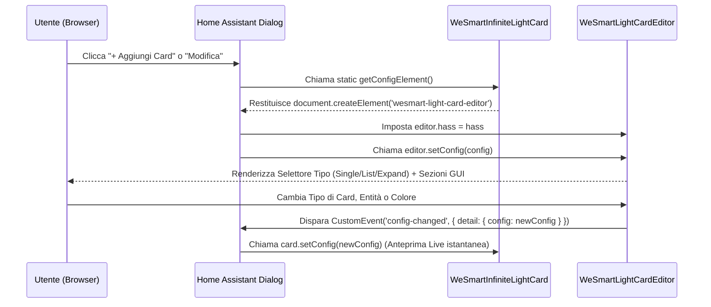

# WeSmart Light Card — Documentazione Tecnica & Architettura (`v2.1.0`)

Questa guida documenta nel dettaglio l'architettura **3-in-1 Unified Suite** di `wesmart-light-card.js` (ispirata al paradigma *Bubble Card*), il funzionamento del **Visual Editor GUI** nativo per Home Assistant Lovelace e tutte le proprietà di configurazione.

---

## 1. Paradigma "3-in-1 Unified Card" (Stile Bubble Card)

Invece di costringere l'utente a installare e cercare tre card diverse per gestire le luci, **`wesmart-light-card.js` (`v2.1.0`)** unifica l'intera esperienza in:

- **1 solo file JavaScript** (`/config/www/wesmart-cards/wesmart-light-card.js`)
- **1 sola voce nel Card Picker di Home Assistant** (*WeSmart Light Card (3-in-1)*)
- **3 modalità operative (`card_type`)** selezionabili dall'utente in cima all'Editor Visuale:
  1. `single` — Controllo completo per singola entità `light.*` (Luminosità, Temperatura Colore Kelvin, Colore Hue RGB).
  2. `list` — Lista compatta multi-entità con Master Toggle di gruppo, toggle rapidi per riga e apertura dialogo *More Info*.
  3. `expand` — Lista multi-entità espandibile a fisarmonica con slider inline animati (Luminosità + Kelvin) per ciascuna luce accesa.

### Risoluzione Automatica della Modalità (`get _mode()`)
La card determina la modalità attiva con questa priorità:
1. Se `config.card_type` è definito (`'single'`, `'list'`, `'expand'`), usa `config.card_type`.
2. Se la card è stata istanziata tramite un tag alias legacy (`custom:wesmart-lights-card` o `custom:wesmart-lights-expand-card`), usa la modalità corrispondente (`'list'` o `'expand'`).
3. Se `config.entities` contiene elementi e `config.entity` è vuoto, usa `'list'`.
4. Altrimenti usa `'single'` (default).

---

## 2. Come Funziona il Visual Editor in Home Assistant Lovelace

Quando l'utente clicca su **"Modifica"** su una card in Home Assistant, Lovelace esegue questo ciclo di vita:



### Componenti chiave dell'architettura (`wesmart-light-card.js`)

1. **`static getConfigElement()`**:
   Metodo statico su `WeSmartInfiniteLightCard` che restituisce `<wesmart-light-card-editor>`. Indica a Home Assistant di montare la nostra interfaccia visuale invece dell'editor YAML testuale.
2. **`static getStubConfig()`**:
   Restituisce la configurazione iniziale quando si aggiunge la card dal selettore visuale (`card_type: 'single'`, `color: '#D97757'`, `theme: 'dark'`, ecc.).
3. **Selettore Tipo di Card (`card_type`) con Migrazione Intelligente**:
   Quando l'utente passa da `single` a `list` o `expand` nell'editor, se `config.entity` era già impostato (es. `light.soggiorno`) e `config.entities` era vuoto, l'editor copia automaticamente `light.soggiorno` come prima voce di `config.entities`. Viceversa, tornando a `single`, recupera la prima entità della lista.
4. **Integrazione ibrida `<ha-form>` + Controlli Custom WeSmart**:
   - All'interno delle sezioni a fisarmonica dell'editor, usiamo `<ha-form>` nativo con gli schema selector ufficiali di Home Assistant (`{ entity: { domain: 'light' } }`, `{ icon: {} }`, `{ text: {} }`) per avere il menu a tendina ricercabile delle luci e il selettore icone MDI ufficiale senza dipendenze esterne.
   - Per il selettore **Tipo di Card**, il **Gestore Lista Luci** (riordino `↑`/`↓`, impostazioni riga `⚙️`, rimozione `✕`) e la **Palette InfiniteColor** (8 preset + color picker nativo + input HEX), usiamo componenti custom in stile WeSmart Dark/Light.

---

## 3. Riferimento Completo delle Opzioni (`config`)

### Opzioni Globali (valide per tutte le modalità)

| Proprietà | Tipo | Default | Descrizione |
|---|---|---|---|
| `type` | `string` | **Obbligatorio** | `custom:wesmart-light-card` |
| `card_type` | `string` | `'single'` | Modalità della card: `'single'`, `'list'` oppure `'expand'`. |
| `color` | `string` | `'#D97757'` | Colore primario HEX (`#RRGGBB`) per il motore **InfiniteColor**. |
| `theme` | `string` | `'dark'` | Tema della card: `'dark'`, `'light'` oppure `'auto'` (segue il sistema operativo). |
| `dynamic_light_color` | `boolean` | `false` | Se `true`, quando una luce RGB è accesa, l'accento della card (o della riga) assume il colore reale della lampadina (`rgb_color`). |
| `show_footer` | `boolean` | `true` | Mostra o nasconde la barra informativa inferiore della card. |

---

### Opzioni Modalità `single` (`card_type: single`)

| Proprietà | Tipo | Default | Descrizione |
|---|---|---|---|
| `entity` | `string` | **Obbligatorio** | ID dell'entità luce (es. `light.soggiorno`). |
| `name` | `string` | `null` | Nome personalizzato (se omesso usa `friendly_name` dell'entità). |
| `icon` | `string` | `null` | Icona MDI personalizzata (es. `mdi:floor-lamp`). |
| `show_brightness` | `boolean` | `true` | Mostra lo slider della luminosità (1–100%). |
| `show_color_temp` | `boolean` | `true` | Mostra lo slider della temperatura colore (Kelvin), se supportato dalla lampadina. |
| `show_color` | `boolean` | `true` | Mostra lo slider della tonalità RGB (Hue 0–360°), se supportato dalla lampadina. |
| `collapse_when_off` | `boolean` | `false` | Se `true`, nasconde tutti gli slider quando la luce è spenta per risparmiare spazio verticale. |

---

### Opzioni Modalità `list` & `expand` (`card_type: list` / `card_type: expand`)

| Proprietà | Tipo | Default | Descrizione |
|---|---|---|---|
| `title` | `string` | `'Lights'` | Titolo mostrato nell'header della card. |
| `icon` | `string` | `'mdi:lightbulb-group'` | Icona mostrata nell'header accanto al titolo. |
| `entities` | `array` | **Obbligatorio** | Lista di stringhe (`light.id`) o oggetti `{ entity, name, icon }`. |

#### Formato degli elementi in `entities`
Ogni elemento dell'array `entities` può essere una stringa semplice oppure un oggetto:

```yaml
entities:
  - light.lampadario_sala
  - entity: light.striscia_led_tv
    name: LED Retro TV
    icon: mdi:led-strip-variant
```

---

## 4. Comportamento Interattivo nelle 3 Modalità

| Azione Utente | `single` | `list` | `expand` |
|---|---|---|---|
| **Tap sul Toggle principale (Header)** | Accende / Spegne la luce | Accende tutte le luci (se tutte spente) o spegne tutte (se almeno una è accesa) | Accende tutte le luci o spegne tutte e chiude i pannelli aperti |
| **Tap su Info Header (Titolo/Icona)** | Apre il dialogo nativo *More Info* di Home Assistant | — | — |
| **Tap su una Riga Luce** | — | Apre il dialogo nativo *More Info* di Home Assistant per quella luce | Espande/chiude a fisarmonica il pannello inline con slider Luminosità e Kelvin (se la luce è accesa); se spenta, la accende |
| **Tap sul Toggle di Riga** | — | Accende / Spegne la singola luce | Accende / Spegne la singola luce (chiudendo il pannello se viene spenta) |
| **Drag sugli Slider** | Regola Luminosità, Kelvin o Hue RGB con anteprima fluida e invio a HA al rilascio | — | Regola Luminosità o Kelvin della singola riga espansa |
